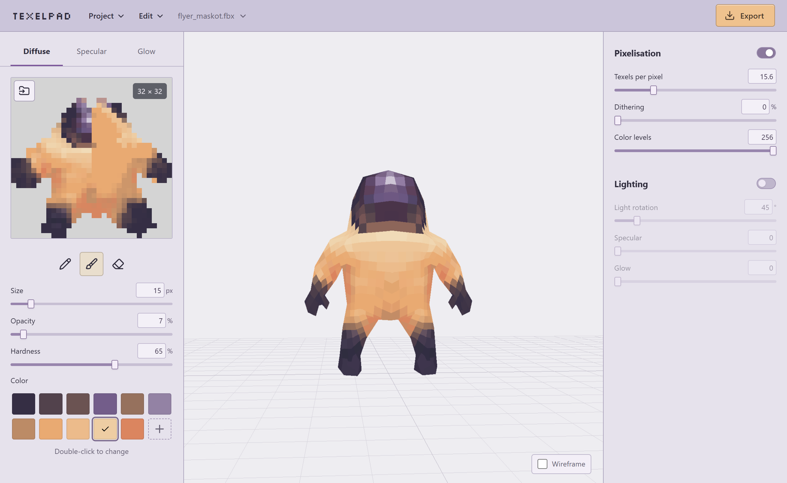

# Texelpad

Paint textures directly on a 3D model or its UV layout. Texelpad runs locally in your browser and exports PNG maps for use in a game engine. Your models and textures stay on your computer.



## Getting started

You need Node.js 22.12 or later and a browser with WebGL2 support. Run these commands in the repository folder:

```sh
npm ci
npm run dev
```

Open [localhost:5179](http://127.0.0.1:5179/). On Windows, you can also use `start.cmd` once the dependencies are installed. Keep the server terminal open while you work.

## Painting

Click **Load model** to open an OBJ or FBX with UVs. Choose a map, then load a PNG or JPEG texture or start painting on the blank map.

- **Diffuse** holds the surface colour and transparency.
- **Specular** controls highlights and reflections. Black means none; white gives full strength.
- **Glow** controls emission, using the diffuse colour.

Specular and Glow start black. Paint on the model or directly in the texture preview. The **UV** button shows the layout over the texture.

The right panel controls pixelisation, colour levels, dithering, and lighting. You can keep adjusting these without changing the painted source pixels. Dithering applies to all three maps before lighting; reduce **Color levels** below 256 to see it.

Save your work through **Project → Save project**. The `.pxwork` file includes the model, maps, settings, and undo/redo history. Open it through **Project → Open project** or drag it into the editor. Save before closing the page; there is no persistent autosave.

## Exporting

**Export** downloads a ZIP with three PNG maps and `material.json`:

- **Original** keeps the source resolution and brushwork, before pixelisation.
- **Pixel grid** matches the current texture previews, with enabled processing baked in.

Both modes fill unused pixels around UV islands to reduce seams. Exporting textures does not save your project.

In a game engine, use nearest filtering, clamp wrapping, and no mipmaps for the pixelated look. Diffuse uses sRGB; Specular and Glow use linear data.

## Controls

| Action | Input |
| --- | --- |
| Pencil / brush / eraser | `P` / `B` / `E` |
| Eyedropper / orbit tool | `I` / `H` |
| Orbit / pan | Right / middle mouse button |
| Zoom | Mouse wheel |
| Frame the model | `F` |
| Smaller / larger brush | `[` / `]` |
| Undo / redo | `Ctrl+Z` / `Ctrl+Shift+Z` |
| Save / open project | `Ctrl+S` / `Ctrl+O` |

Use `Cmd` instead of `Ctrl` on macOS. You can also paint with one finger on a touchscreen.

## Limits

One set of maps per model, one UV tile, up to 200,000 triangles, and textures up to 4096 × 4096. Overlapping UVs share paint. UDIM, animation, and UV editing are not supported.

## Development

```sh
npm test
npm run build
npx playwright install chromium
npm run test:browser
```

Browser tests use an isolated Chromium instance and a simple cube fixture. They cover painting, UV seams, processing, saving, and export.

The build goes into `dist/`. Run `npm run preview` to view it locally.

## License

[MIT](LICENSE). Silkscreen is included under the [SIL Open Font License](public/fonts/silkscreen/OFL.txt).
